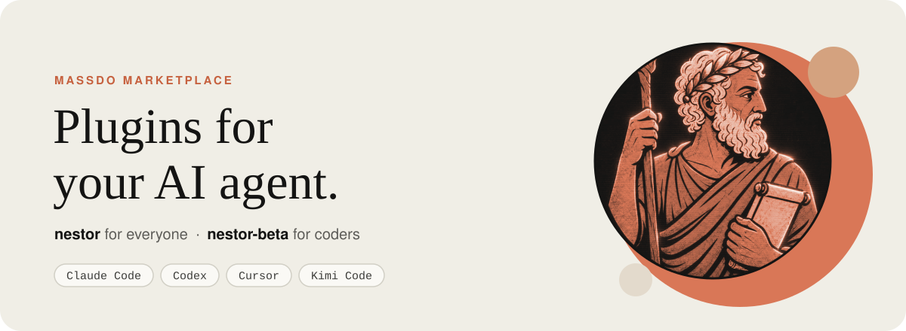
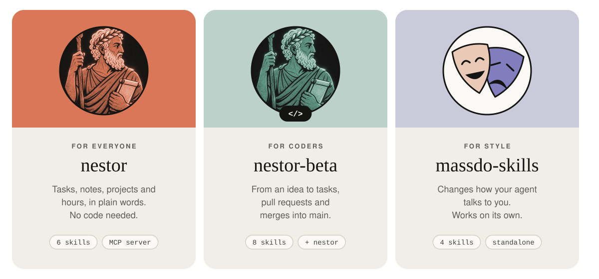
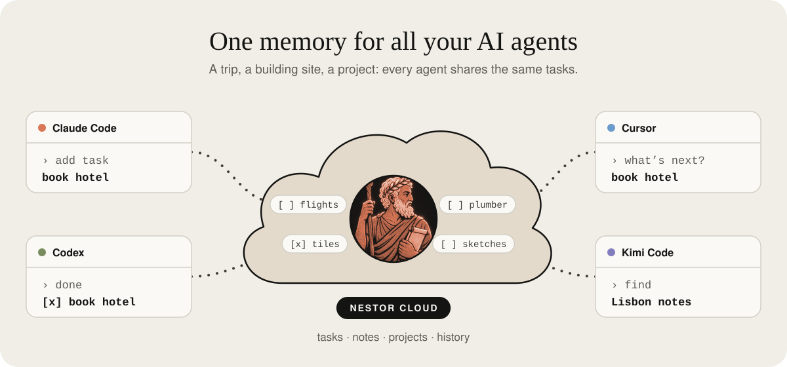
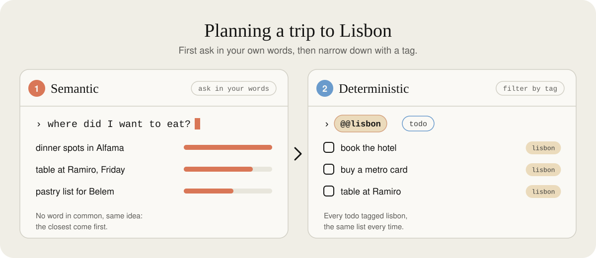
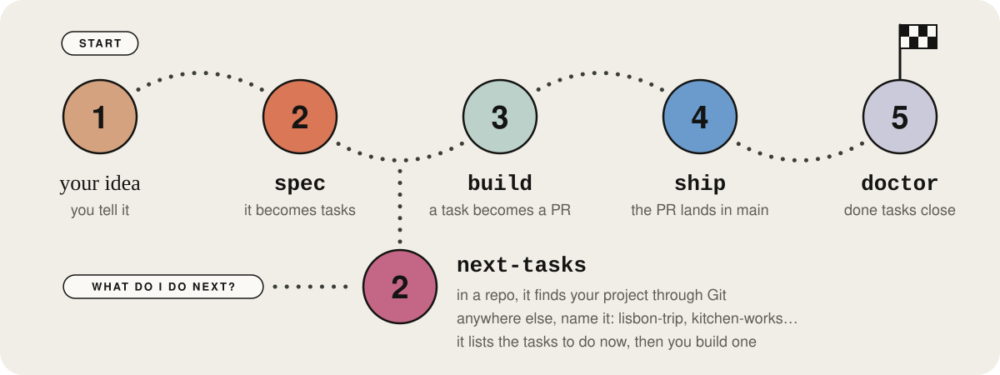

<p align="center">
  
</p>

<p align="center">
  <b>Your tasks, notes and projects, with Nestor.</b><br>
  Set it up once, then ask for what you need in your own words.
</p>

<br>

## Install

**You need** [Claude Code](https://code.claude.com/docs/en/quickstart),
[Codex](https://learn.chatgpt.com/docs/codex/cli) or
[Cursor Agent](https://docs.cursor.com/en/cli/installation), installed and signed in,
plus [Git](https://git-scm.com/install/). For claude.ai or ChatGPT, nothing to
install: the wizard shows the steps to follow in your browser.

**1. Paste this in a terminal, then press Enter.**

```bash
curl -fsSL https://raw.githubusercontent.com/massdo/massdo-marketplace/main/install.sh | bash
```

<sub>On a Mac, press <b>⌘ Space</b>, type <b>Terminal</b>, then press <b>Enter</b> to open one.</sub>

<details>
<summary>On Windows, use PowerShell instead</summary>

Open **Start**, search for **PowerShell**, open it, paste this block, then press **Enter**.

```powershell
$installerPath = Join-Path ([IO.Path]::GetTempPath()) ('nestor-' + [guid]::NewGuid() + '.ps1')
try {
    Invoke-WebRequest -UseBasicParsing 'https://raw.githubusercontent.com/massdo/massdo-marketplace/main/install.ps1' -OutFile $installerPath
    powershell.exe -NoProfile -ExecutionPolicy Bypass -File $installerPath
} finally {
    Remove-Item -LiteralPath $installerPath -ErrorAction SilentlyContinue
}
```

Windows setup works with Codex and Claude Code, and asks you to type `codex`, `claude`,
`claude-ai` or `chatgpt`.
It needs `codex.exe` or `claude.exe` on `PATH` and rejects `.cmd`, `.bat` and `.ps1`
launchers, including the npm shims `codex.cmd` and `claude.cmd`. It supports Windows
PowerShell 5.1+ and PowerShell 7. With WSL, run the Mac or Linux command in your WSL terminal.

</details>

**2. Pick your apps and sign in.** Press **Enter** to check an app, then move to
**Launch install** and press **Enter** again. Check **claude.ai** or **ChatGPT** to
get the steps to follow in your browser.
When asked to open your browser, press **y** and allow the connection.
For Codex, ignore the `Callback URL` prompt shown while the browser is open:
the sign-in completes on its own.

**3. Open a new conversation** once each app shows a **✔** line and you see
**`Installation complete`**, and type:

```text
Show my tasks.
```

<details>
<summary>Setup did not finish?</summary>

- **`Nestor is installed — finish connecting your account`**: the line above it says why. Follow the message, or paste the setup command again to continue.
- **Cursor** does not show Nestor yet: reload the app or start a new Agent session.
- **Connection lost**: reconnect to the internet, then paste the setup command again.

For anything else, [ask for help](https://github.com/massdo/massdo-marketplace/issues/new)
and tell us whether you use Mac, Windows or Linux, and which app you chose.

</details>

<details>
<summary>Remove Nestor</summary>

On Mac or Linux, run the removal wizard:

```bash
curl -fsSL https://raw.githubusercontent.com/massdo/massdo-marketplace/main/uninstall.sh | bash
```

It lists the apps found on your computer, preselects the ones that have Nestor,
and removes it from the apps you confirm. The shared marketplace stays available
for any other plugins you use. In claude.ai and ChatGPT, remove Nestor from the
page where you added it.

</details>

<details>
<summary>Install by hand, with the optional plugins</summary>

These commands replace the setup above and include all three plugins.
For Nestor alone, keep the marketplace command and the `nestor` line.
Connection and recovery instructions are in the [setup reference](docs/installation.md).

**Claude Code**

```bash
claude plugin marketplace add massdo/massdo-marketplace
claude plugin install nestor@massdo-marketplace
claude plugin install nestor-beta@massdo-marketplace
claude plugin install massdo-skills@massdo-marketplace
```

**Codex**

```bash
codex plugin marketplace add massdo/massdo-marketplace
codex plugin add nestor@massdo-marketplace
codex plugin add nestor-beta@massdo-marketplace
codex plugin add massdo-skills@massdo-marketplace
```

**Cursor**, then run **Developer: Reload Window**

```bash
git clone https://github.com/massdo/massdo-marketplace.git "$HOME/massdo-marketplace"
mkdir -p "$HOME/.cursor/plugins/local"
cp -R "$HOME/massdo-marketplace/plugins/nestor" "$HOME/.cursor/plugins/local/nestor"
cp -R "$HOME/massdo-marketplace/plugins/nestor-beta" "$HOME/.cursor/plugins/local/nestor-beta"
cp -R "$HOME/massdo-marketplace/plugins/massdo-skills" "$HOME/.cursor/plugins/local/massdo-skills"
```

**Kimi Code**, then the commands below in the TUI

```bash
git clone https://github.com/massdo/massdo-marketplace.git "$HOME/massdo-marketplace"
```

```text
/plugins install ~/massdo-marketplace/plugins/nestor
/plugins install ~/massdo-marketplace/plugins/nestor-beta
/plugins install ~/massdo-marketplace/plugins/massdo-skills
/reload
```

**claude.ai**, from [Customize › Connectors](https://claude.ai/customize/connectors)

Click **Add**, then **Add custom connector**. Name it `Nestor`, paste the URL
below, click **Continue** twice, then **Add**, and sign in when asked.

```text
https://journal.mcp-marketplace.org/mcp
```

**ChatGPT**, from [Plugins](https://chatgpt.com/plugins)

Click **+**, then **Add custom MCP server**. Name it `Nestor`, paste the same URL
under **Connection**, keep the OAuth sign-in, then click **Create as a plugin**
and install it. In a new conversation, type `@` and pick Nestor.

</details>

## Four plugins

<p align="center">
  
</p>

Start with **nestor** to manage your tasks, notes and projects. No coding needed.
**nestor-beta** adds coding tools. **massdo-skills** changes how your assistant responds.
**agent-queue** shows which Claude Code sessions wait on you. All three are optional.

## Use

Tell Nestor what you need in your conversation with Codex or Claude Code. For example:

```text
Show my tasks.
Add "Call the dentist" to my tasks.
Find my notes about Lisbon.
```

<details>
<summary>Optional: commands and shortcuts</summary>

You can also use a command for a specific action:

```text
Claude Code   /nestor:tree
Codex         $nestor:tree
Cursor        /tree
Kimi Code     /skill:tree
```

The command lists below use the Claude Code format.

</details>

### nestor · for everyone

Like the old king of Pylos, it remembers everything. Tasks, notes, projects and hours, in plain words. No code needed: mention a task and it shows up on its own.

<p align="center">
  
</p>

A trip, a building site, a client project, a family move: your tasks live in the cloud, not in one agent. Add “book hotel” in Claude Code, Cursor tells you it is next, Codex ticks it off, Kimi Code finds your Lisbon notes.

<p align="center">
  
</p>

Two ways to find them. **Semantic** search understands what you mean, even with other words. **Deterministic** search sticks to exact words, tags and filters, like the tags in Apple Notes, and gives the same list every time. Ask in plain words and nestor mixes both.

<details>
<summary>Show Nestor shortcuts and advanced options</summary>

- `/nestor:nestor` — tasks, notes, projects, history
- `/nestor:activity` — start a timer, get your hours
- `/nestor:tree` — draws a project as a tree
- `/nestor:explain` — explains a text, a task or a project as text, a web page or a video
- `/nestor:pause` — saves this chat's work context for later
- `/nestor:resume` — restores this chat's context without changing it
- `/nestor:resume list` — lists saved transmissions, newest first, for explicit selection
- `/nestor:resume <slug>` — restores that transmission directly
- `/nestor:check-for-updates` — looks for an update

Invoke `pause` and `resume` without a project argument: transmissions belong to a chat, not to a project. Pause saves only this chat's work and replaces its previous transmission; text after `pause` tells it what to emphasize. Resume restores this chat's transmission, or the one whose slug you give; otherwise it lists every transmission, newest first, and waits for your choice. Resume preserves transmissions and starts no work. To delete one, ask for it like any item.

> [!NOTE]
> nestor plugs in the only MCP server in the house: `https://journal.mcp-marketplace.org/mcp`

</details>

### nestor-beta · for coders

Nestor learned to code. It takes you from an idea to merged pull requests. Install it **on top of** nestor.

<p align="center">
  
</p>

Two ways in. **New idea?** Start with `spec`. **Not sure what to do next?** Run `next-tasks`: in a repo it finds the project through Git, anywhere else you name it (`/nestor-beta:next-tasks lisbon-trip`), and it lists what to do now.

- `/nestor-beta:spec` — turns your idea into a task tree, one question at a time
- `/nestor-beta:next-tasks` — lists a project’s active tasks
- `/nestor-beta:build` — turns a task into a pull request
- `/nestor-beta:ship` — merges open PRs into `main` (`ship list` only looks)
- `/nestor-beta:doctor` — offers to close tasks that already shipped
- `/nestor-beta:clean-task` — tidies up a task
- `/nestor-beta:audit` — has an independent Codex or Claude agent (`codex sol best max`, `claude opus best`…) audit a task or plan, then logs its report in a note linked to it; give a PR number instead to audit that pull request
- `/nestor-beta:check-for-updates` — looks for an update
- `/nestor-taches` — Claude Code only: a side pane with the project’s tasks as `next-tasks` reads them, colored statuses, and Spec and Build buttons on each task

Behind the scenes, `nestor-beta` signs your pull requests with a `nestor tasks:` footer. Nothing to type.

### massdo-skills · for style

Changes how your agent talks to you. A style stays on until `reset`.

- `/massdo-skills:answer-short` — short answers, 120 words max
- `/massdo-skills:articulate` — full sentences that connect
- `/massdo-skills:chief-of-staff` — decides instead of handing you a menu
- `/massdo-skills:extract-signal` — sorts raw text, then acts on it (`raw` returns the sorted text only)

### agent-queue · for Claude Code on a Mac

Every session of the Claude Code desktop app in one pane, and a jump to the one that waits on you. Claude Code desktop on macOS only.

```bash
claude plugin install agent-queue@massdo-marketplace
```

- `/open-agent-queue` — opens the **Agents** pane, in Claude Code's colors: yellow for a question, with its text, blue for finished, grey for working. A btw or a fork sits under its session, and **Here:** names the project and session you are in
- `/next` — opens the session that has waited on you longest: finished ones first, then the questions still unanswered, in turn

Optional: a global shortcut, ⌘@ by default, that does `/next` from any app. Build it once, and again after an update. If no key types `@` on your keyboard, give another one, as in `install.sh '§'`.

```bash
sh "$(ls -td ~/.claude/plugins/cache/massdo-marketplace/agent-queue/*/ | head -1)hotkey/install.sh"
```

<br>

<p align="center"><sub>Made by massdo</sub></p>
